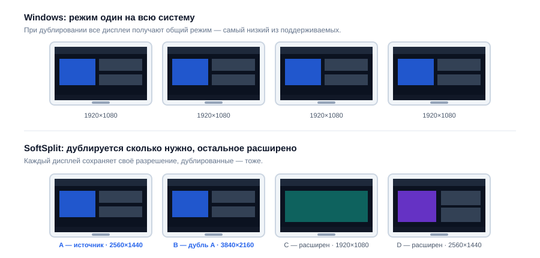

# SoftSplit

**Гибкое дублирование и расширение мониторов в Windows.**

Любой монитор можно продублировать на любое количество других мониторов, а оставшиеся
оставить расширенными — и при этом задать каждому дисплею **своё** разрешение.
Windows так не умеет: у неё дублирование включается сразу для всех экранов и приводит
их к одному общему режиму.

<p align="center">
  
</p>

---

## Проблема

Стандартные средства Windows предлагают два глобальных режима на всю систему:

1. **«Расширить»** — каждый дисплей получает свою часть рабочего стола.
2. **«Дублировать»** — *все* дисплеи показывают один и тот же рабочий стол.

Из этого следуют три ограничения, с которыми сталкивается любой, у кого больше двух экранов:

| Ограничение Windows | Что происходит на практике |
|---|---|
| Дублирование только целиком | Нельзя «продублировать пару, а остальные оставить расширенными» — режим задаётся для всей системы |
| Общий режим для клонов | Дублированные дисплеи получают одно разрешение — обычно самое низкое из поддерживаемых, поэтому картинка на большом экране мылится |
| Разрешение не выбирается отдельно | В режиме дублирования нельзя оставить монитору 4K, а клону — 1080p, хотя физически каждый дисплей способен на своё |

## Что делает SoftSplit

Вы назначаете каждому дисплею роль:

- **Расширить** — обычный независимый рабочий стол (поведение по умолчанию);
- **Дублировать** — показывать на этом дисплее содержимое другого, выбранного дисплея.

Из этого складывается любая схема: три дисплея дублируют один, а четвёртый остаётся
расширенным; два показывают разное и дублируются каждый на свой второй экран; и так далее.

Разрешение задаётся **для каждого дисплея отдельно** — включая те, что работают в режиме
дублирования. Дублированный дисплей рендерится в своём нативном режиме, поэтому картинка
не деградирует до самого слабого устройства.

## Возможности

- Иконка в **системном трее** — включение, выключение, настройки, выход.
- **Автозапуск** при входе в систему (переключатель в настройках, без прав администратора).
- Настройка «источник → приёмники» через обычное окно: никаких консольных команд.
- **Отдельное разрешение и масштабирование** для каждого дисплея.
- Три способа вписать картинку: с сохранением пропорций, с обрезкой по краям и растяжение.
- **Быстрый режим вывода**: кадр переносится силами видеокарты, процессор почти не
  участвует (2–3 % одного ядра).
- Режим совместимости — для машин без Direct3D 11 и для случаев, когда нужен курсор мыши.
- Ограничение частоты кадров (10–60 fps) — можно подобрать баланс между плавностью и
  нагрузкой.
- Один экземпляр программы, настройки в `%APPDATA%\SoftSplit\config.json`.
- Аварийная кнопка «Вернуть обычную раскладку» — если эксперименты с режимами что-то
  нарушили.

## Установка

1. Скачайте последний архив со страницы [Releases](https://github.com/nikkawaf-rgb/SoftSplit/releases/latest).
2. Распакуйте в любую папку (например, `C:\Program Files\SoftSplit` или `D:\Tools\SoftSplit`).
3. Запустите `SoftSplit.exe`.

Установщик не нужен, права администратора не нужны, дополнительных компонентов
(рантаймов, кодеков, драйверов) — тоже.

## Быстрый старт

1. Запустите `SoftSplit.exe` — в трее появится иконка, окно настроек откроется сразу.
2. В списке дисплеев у каждого экрана выберите роль:
   - **Расширить** — оставить как есть;
   - **Дублировать** — и укажите в выпадающем списке, какой дисплей показывать.
3. При необходимости задайте разрешение (кнопка «Разрешение») и способ масштабирования.
4. Нажмите **«Применить»**.

Чтобы включить или выключить дублирование позже, достаточно меню иконки в трее.

## Требования

- Windows 10 или Windows 11, x64.
- Одна или несколько видеокарт, подключённых к системе дисплеев — любая комбинация.
- Права администратора **не требуются**.

## Ограничения

- Дублирование выполняется **программно** (захват кадра и вывод в окно), а не на уровне
  драйвера. Отсюда: задержка около одного кадра, защищённый контент (DRM) может выглядеть
  чёрным, полноэкранные игры в эксклюзивном режиме — тоже.
- Курсор мыши не рисуется в быстром режиме; если он нужен, включите режим совместимости.
- Сетевой трафик программа не создаёт: дублирование идёт внутри одной машины, «пинга» в
  сети нет. Подробности и объяснение цифр — в [docs/LIMITATIONS.md](docs/LIMITATIONS.md).

## Документация

| Документ | О чём |
|---|---|
| [docs/HOW-IT-WORKS.md](docs/HOW-IT-WORKS.md) | Как устроено внутри и почему именно так |
| [docs/LIMITATIONS.md](docs/LIMITATIONS.md) | Честно об ограничениях, задержке и нагрузке |
| [docs/TROUBLESHOOTING.md](docs/TROUBLESHOOTING.md) | Что делать, если не работает |
| [docs/DEVELOPMENT.md](docs/DEVELOPMENT.md) | Сборка, структура проекта, отладка |
| [CHANGELOG.md](CHANGELOG.md) | История версий |
| [ROADMAP.md](ROADMAP.md) | Планы |

## Сборка из исходников

```powershell
dotnet build .\src\SoftSplit\SoftSplit.csproj -c Release
```

Подробности и требования — в [docs/DEVELOPMENT.md](docs/DEVELOPMENT.md).

## Лицензия

MIT — см. [LICENSE](LICENSE). Проект бесплатный, без подписок и встроенных ограничений.

---

## English summary

SoftSplit is a free Windows utility that removes two limits of the built-in display
management: you can duplicate **any** subset of your monitors while the rest stay extended,
and every display — duplicated or not — keeps **its own** resolution.

Windows only offers global "Extend" and "Duplicate" modes, and duplication forces all clones
into one shared (usually the lowest) mode. SoftSplit maps per-display roles instead and renders
each duplicated target at its native mode, so a 4K panel is not dragged down to match a
1080p monitor.

- Lives in the system tray, optional autostart, no installer, no admin rights, no dependencies.
- Software mirroring (capture + window), so expect ~1 frame of latency; DRM content and
  exclusive-fullscreen games may show black. See [docs/LIMITATIONS.md](docs/LIMITATIONS.md).
- MIT licensed, built from source with the .NET SDK.
